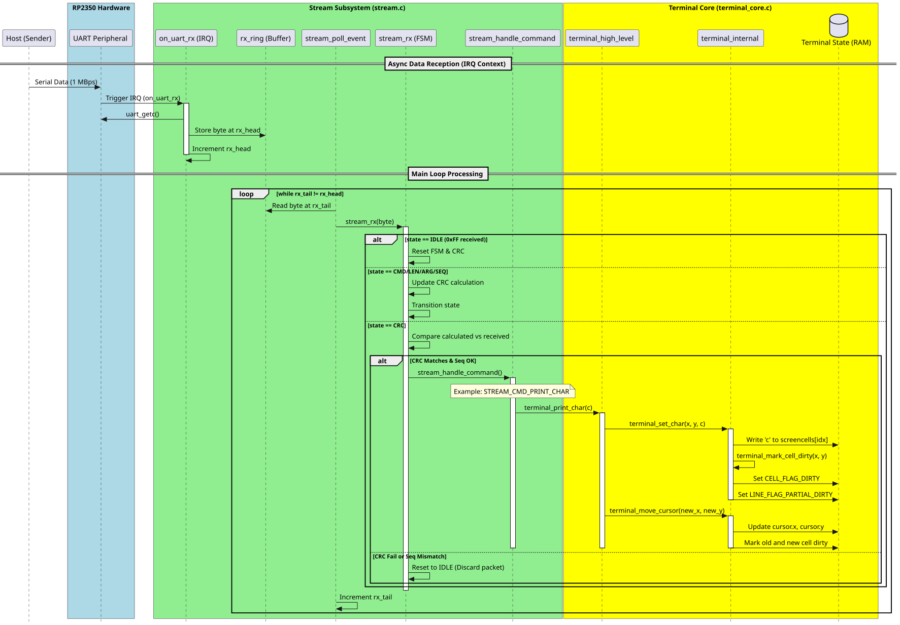

## Abstract 
The communication protocol implemented uses a simple ring buffer and state machine to parse incoming commands over UART. These commands then mutate the terminal state in memory, without directly touching the rendering path. This makes receiving commands low overhead and ensures no backpressure or flow control is needed while not losing commands.

## Introduction
The terminal is split into two parts, the terminal core and terminal rendering. The terminal core represents the state of the terminal in memory. This state is altered through a communication interface. This together creates the input and representation of the terminal that can be handed off to a rendering loop to show the state on a display.

## Problem Definition
The system must process high-speed serial data and translate it into terminal actions without losing data or blocking the host.

### Requirements
- R1: Support for standard terminal operations
- R2: Automatic scrolling when the cursor exceeds the row limit
- R3: Detection of corrupted packets
- R4: Efficient memory usage

## Communication Protocol
### Specification
The protocol used is UART. This is chosen for its simplicity and reliability. The RP2350 has 2 UART controllers and most microcontrollers chosen as host will also have at least 1 UART connection. The exact parameters are:
- Baudrate: 1 MBps
- Protocol: 8N1

### Structure
Packets are transmitted in a binary format, they follow the following packet layout.

| Sync (0xff) | Cmd (1B) | Len (1B) | Args (0-64) | Seq (1B) | CRC (1B) | 

Where:
- Sync: A `0xff` byte used to align the receiver's state machine
- Cmd: Defines the action the receiver needs to take
- Len: Specifies how many bytes the `Args` field holds. Can range from 0 (e.g. backspace) to 64 (e.g. larger strings)
- Seq: A rolling sequence number used to track packet order. The first received sequence number is always accepted as baseline, afterwards a `RESYNC` command is needed to reset.
- CRC: A CRC8 checksum calculated across `Cmd`, `Len` and `Args` fields to detect corrupted packets.

## Implementation
### IRQ UART receiver
```C++
void on_uart_rx() {
    while (uart_is_readable(UART_ID)) {
        uint8_t b = uart_getc(UART_ID);
        uint16_t next = (rx_head + 1) % RX_RING_SIZE;

        if (next != rx_tail) { // avoid overflow
            rx_ring[rx_head] = b;
            rx_head = next;
        }
    }
}
```
The function above is registered as a callback function for the UART IRQ. It reads out the hardware FIFO and manually transfers it into a ring buffer in RAM. This is chosen for future flexibility, as this is a good point to measure the buffer overhead and, if needed, throttle the incoming messages from the host. For now however, it is a good way to make the FIFO buffer from the UART peripheral less of a bottle neck for short bursts of data.

### Stream RX state machine
```C++
void stream_rx(uint8_t b){
    switch(stream_state.rx_state){
        // On a sync byte, we reset and move on to receiving the CMD
        case STREAM_RX_STATE_IDLE:
            process_state_idle(b);
            break;
        
        // Store command and start generating CRC
        case STREAM_RX_STATE_CMD:
            process_state_cmd(b);
            break;

        // Receive length (even no packets with no payload have a length byte)
        case STREAM_RX_STATE_LEN:
            process_state_len(b);      
            break;

        case STREAM_RX_STATE_ARG:
            process_state_arg(b);
            break;

        // Check the sequence byte so no messages were missed
        case STREAM_RX_STATE_SEQ:
            process_state_seq(b);
            break;
        
        // Handle command if transmitted CRC matches our 
        case STREAM_RX_STATE_CRC:
            process_state_crc(b);
            break;
    }
}
```
This is the main entry point for every byte, which is then dispatched to a helper function depending on the state of the state machine. This is stored in a context struct.
```C++
typedef struct {
    STREAM_RX_STATE rx_state;
    STREAM_CMD      cmd;
    uint8_t         length;
    uint8_t         data[STREAM_MAX_PAYLOAD];
    uint8_t         buf_idx;
    bool            seq_initialized;
    uint8_t         prev_seq;
    uint8_t         seq;
    uint8_t         crc;
} stream_state_t;
```

This state struct together with the main dispatch switch case statement and helper functions for the different states builds the incoming bytes up into full commands. The last check is performed in the CRC state, to check whether the packet was received fully in tact. The CRC is updated in every state that mutated the CRC in the host. The check is done with the following helper function
```C++
void process_state_crc(uint8_t b){
    if (b == stream_state.crc){
        // RESYNC packets bypass sequence validation
        if (stream_state.cmd == STREAM_CMD_RESYNC) {

            stream_state.prev_seq = stream_state.seq;
            stream_state.seq_initialized = true;
            stream_state.rx_state = STREAM_RX_STATE_IDLE;
            return;
        }

        // First packet accepted unconditionally
        if (!stream_state.seq_initialized) {
            stream_state.prev_seq = stream_state.seq;
            stream_state.seq_initialized = true;
        }
        else if ((uint8_t)(stream_state.prev_seq + 1) != stream_state.seq) {

            // Sequence mismatch -> reject packet
            stream_state.rx_state = STREAM_RX_STATE_IDLE;
            return;
        }
        else {
            stream_state.prev_seq = stream_state.seq;
        }

        stream_handle_command();
    }

    stream_state.rx_state = STREAM_RX_STATE_IDLE;
}
```
This function also checks for the sequence, as handle command is only called at the end of a packet. If the sequence is checked earlier and messages are discarded too soon, a `RESYNC` packet would be ignored. Once the full packets is built back up, `stream_handle_command()` is called to call the right method of the `terminal_core` depending on the command received. If needed it passess the arguments in this function call.

### Decoupling of UART receive, terminal state and rendering

The sequence diagram above highlights some of the more important choices in this implementation. The main optimization for this receiver is decoupling the state of the terminal from rendering calls. This is done by sharing a single terminal state, where the `stream.c` module calls `terminal_core` functions that just mutate the state in memory. Then, from main, a separate method from `terminal_render` is called that performs a render pass, using the `renderer` and the shared `terminal_state_t` struct.

The state is tracked using the following structs:
```C++
typedef struct{
    uint16_t            cols;
    uint16_t            rows;
    uint16_t            viewport_start;
    cursor_t*           cursor;
    terminal_cell_t*    cells;
    terminal_line_t*    lines;
    color_t             default_fg;
    color_t             default_bg; 
} terminal_t;
```
This struct defines the full terminal state, including some definitions like the count of colums and rows and the default colors used. It also contains links to the state of the cells in the terminal and the cursor object.
```C++
typedef struct{
    char        c;
    color_t     fg;
    color_t     bg;
    uint8_t     flags;
} terminal_cell_t;
```
The cell struct contains information about what character is present on this cell. The indexing is done implicitly based on pointer arithmetic and the height and width of the grid defined in the terminal struct. The `flags` byte contains a flag called `CELL_FLAG_DIRTY`. This flag is set by the UART receiver path to show that the state of this cell has changed. During the render pass, these flags are used to see what cells should and should not be rendered. This allows for the receiver and the renderer to be fully decoupled.

### Future improvements
#### Retry logic
The current UART implementation has room for an acknowledgement system. This can be implemented based on the CRC and sequence byte. An ack can be sent per sequence number of a packet when the CRC is correct. The host/sender can then verify whether a packet was properly received or needs to be retried.

#### Flow control
If high bursts eventually overflow the UART peripheral FIFO or in memory ring buffer, flow control can be implemented to stop the host/sender from sending more packets while the renderer or terminal is still catching up and processing previous packets. This can be done through setting a GPIO pin in software on the RP2350 when the ring buffer is overflowing and either manually checking for this pin being set or through hardware UART flow control on the host/sender.